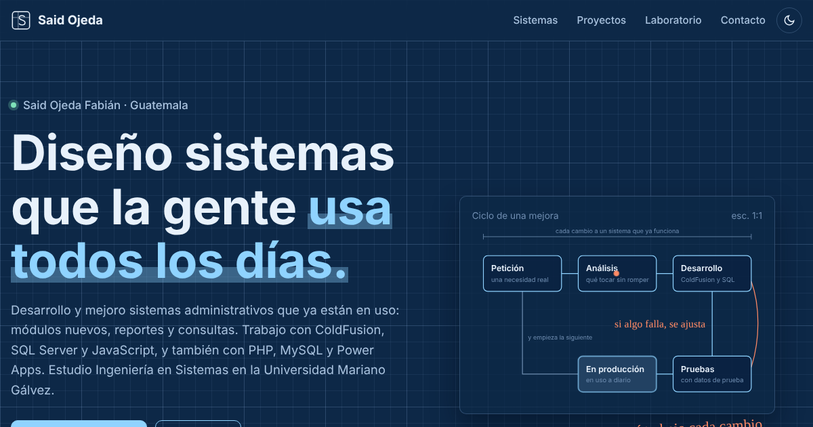
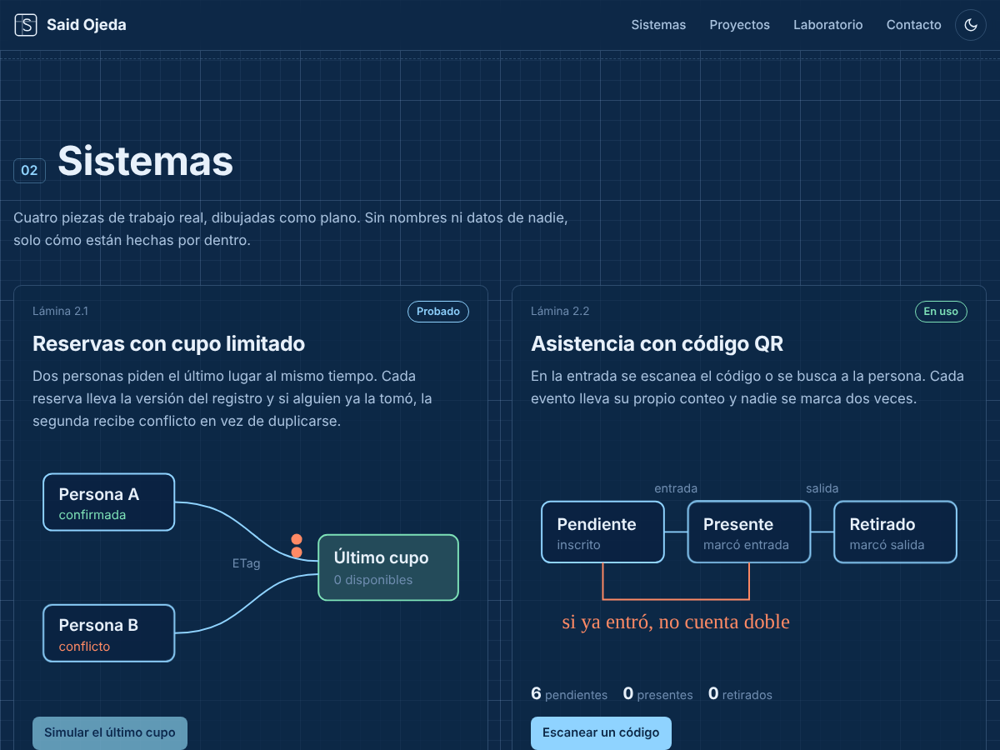

# Portafolio de Said Ojeda

Mi portafolio, armado como si fuera un plano técnico. Cada sección es una hoja y el cajetín de abajo te dice en cuál vas.

**Verlo en vivo:** https://said1ojeda.github.io/POrtafolioDigiSaid/



## Qué tiene

| Hoja | Sección | Qué hay |
|---|---|---|
| 01 | Portada | Quién soy, con un diagrama del ciclo de una mejora que se dibuja solo |
| 02 | Sistemas | Cuatro sistemas reales dibujados como plano, dos se pueden probar con un botón |
| 03 | Proyectos | Matriz con todos los proyectos, filtros y el estado real de cada uno |
| 04 | Laboratorio | Mis repos más recientes, leídos en vivo de la API de GitHub |
| 05 | Contacto | Correo, LinkedIn, WhatsApp y GitHub |



## Cómo está hecho

HTML, CSS y JavaScript, sin frameworks ni plantillas.

- `css/plano.css` lleva todos los colores y medidas en variables, con tema oscuro tipo plano azul y tema claro tipo papel de calco.
- `js/plano.js` maneja el tema, el cajetín, los trazos animados y los números en vivo.
- `js/sistemas.js` tiene las dos simulaciones, la del último cupo y la del escáner de asistencia.
- `js/proyectos.js` guarda los datos de la matriz y la pinta con sus filtros.
- `js/laboratorio.js` lee los repos de GitHub y, si la API no responde, muestra una lista guardada.

Funciona bien en el cel, se puede usar con teclado y respeta cuando el sistema pide menos movimiento.

## Los estados de los proyectos

- **En uso**, se usa de verdad en el día a día.
- **Probado**, pasó pruebas pero no lo presento como sistema en producción.
- **Prototipo**, funciona pero quedó a medias o para uso personal.
- **Propuesta**, idea diseñada que todavía no se construye.
- **Académico**, hecho para la universidad.

Los sistemas del trabajo no tienen código público. En el portafolio aparecen sin nombres, datos ni nada que identifique a la institución.

## Correrlo en tu compu

No necesita instalar nada.

```bash
git clone https://github.com/Said1Ojeda/POrtafolioDigiSaid.git
cd POrtafolioDigiSaid
python -m http.server 8080
```

Y abres `http://localhost:8080`.

## Licencia

MIT, ver [LICENSE](LICENSE).
